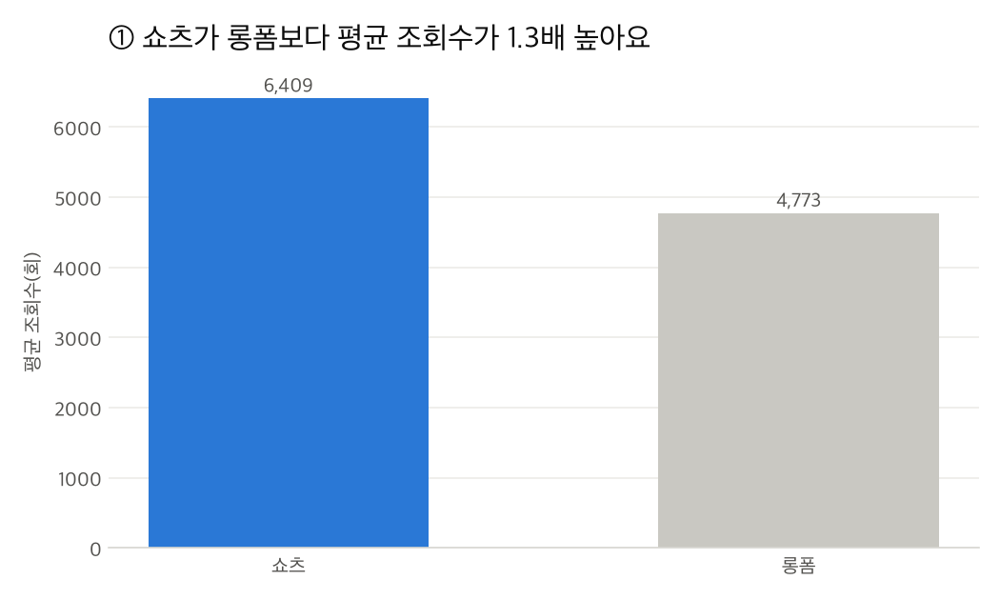
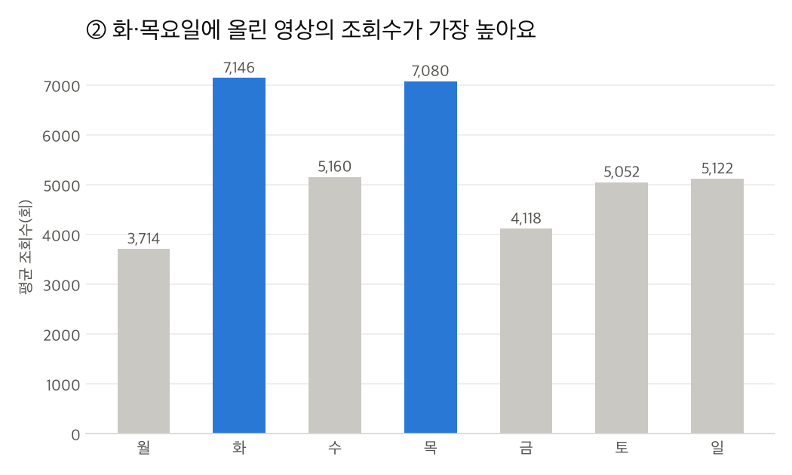
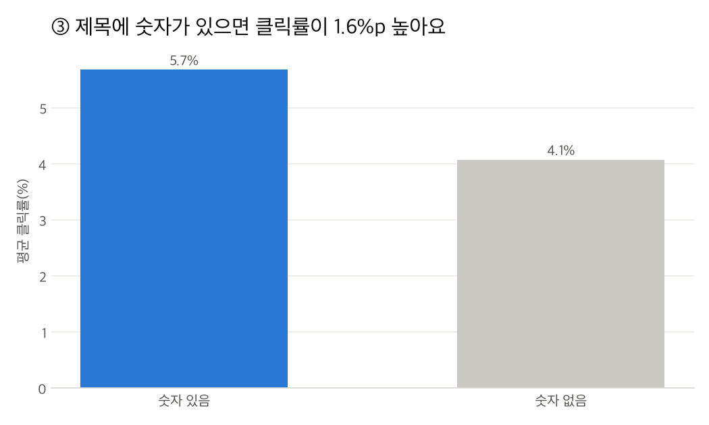
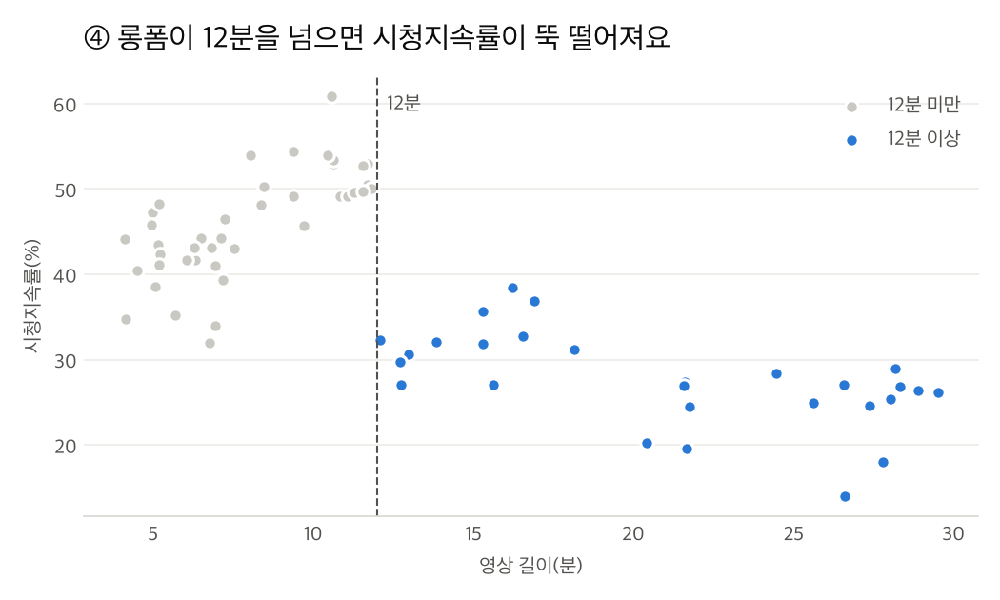

# 채널 영상 120개 성과 리포트

- 데이터: `data/채널_영상통계.csv` (가상 채널, 2025년 1~12월, 영상 120개)
- 기준: 영상을 묶음(형식·요일·제목·길이)으로 나눈 뒤 **묶음별 평균**을 비교했어요. 개수가 아니라 평균 기준이에요.
- 그래프 만든 코드: `결과/그래프만들기.py`

## 한 줄 요약
**쇼츠로, 화·목요일에, 제목에 숫자를 넣어서** 올리고, 롱폼은 **12분 안**으로 끝내면 좋아요.

---

## ① 형식: 쇼츠가 조회수 1.3배

| 형식 | 영상 수 | 평균 조회수 | 평균 시청지속률 |
|---|---|---|---|
| 쇼츠 | 51개 | 6,409회 | 68.5% |
| 롱폼 | 69개 | 4,773회 | 38.5% |

## ② 요일: 화·목요일이 가장 높음

- 화(7,146회)와 목(7,080회)이 가장 높고, 월(3,714회)이 가장 낮아요. 약 1.9배 차이예요.
- 쇼츠만 봐도, 롱폼만 봐도 화·목이 높았어요. 그래서 "쇼츠를 화·목에 많이 올려서 생긴 착시"는 아니에요.

## ③ 제목: 숫자가 있으면 클릭률 +1.6%p

- 예: "5가지만 알면 끝", "3단계 따라하기 실습"
- 쇼츠(5.71% vs 4.12%)와 롱폼(5.65% vs 4.05%) 모두 같은 차이가 났어요.
- 물음표로 끝나는 질문형 제목은 클릭률이 4.02%로 오히려 낮았어요.

## ④ 롱폼 길이: 12분을 넘으면 시청지속률이 뚝

- 12분 미만 롱폼은 평균 45.9%, 12분 이상은 27.7%예요.
- 11.8분짜리 영상은 50%인데, 12.1분짜리 영상은 32%예요. 12분에서 끊기듯 떨어져요.

## 차이가 없던 것
- 주제(엑셀, PDF, GitHub, 프롬프트 등)와 월별 조회수는 뚜렷한 차이가 없었어요.
